<p align="center">
  
</p>

<p align="center">
  <picture>
    <source media="(prefers-color-scheme: dark)" srcset="https://readme-typing-svg.demolab.com?font=Fira+Code&weight=500&size=20&pause=1400&color=3CB878&center=true&vCenter=true&width=640&lines=Designing+interfaces+in+Figma.;Building+them+with+Vue+and+React.;Turning+visual+identities+into+design+systems.;Probably+redesigning+something+right+now.">
    
  </picture>
</p>

<div align="center">
  
</div>

<br>


I'm a developer from Brazil with a degree in Computer Science from UFFS. I currently work as an AI development analyst.

The part I keep coming back to is the one people actually touch. How a screen looks, how its pieces turn into a system of colors, type and components, and how that system becomes front-end code without losing anything on the way. That's where I'm taking my work now: product design, design systems and front-end.

##  Me, as design tokens

```css
:root {
  --name: "Ana Clara";
  --day-job: "AI development analyst";
  --is-passionate-about: product-design, design-systems, front-end;
  --designs-in: figma;
  --builds-with: vue, react, html, css, javascript;
  --side-projects: always-one-open;
  --accent: #1B7D4F; /* green, always */
}
```

##  Toolbox

**Design and front-end**

<a href="https://skillicons.dev"></a>

**Also in my hands**

<a href="https://skillicons.dev"></a>

Plus SQL, Oracle, object-oriented programming and a lot of RPA.

##  Say hi

<p>
  <a href="https://www.linkedin.com/in/ana-clara-brusamarello-barbosa-761091326/">
    
  </a>
  <a href="mailto:aclarabrusa@gmail.com">
    
  </a>
  <a href="https://instagram.com/claeruh">
    
  </a>
  <a href="https://open.spotify.com/user/xuekkld08hrqufar221luzcm7">
    
  </a>
</p>

<br>

<p align="center">
  
</p>
